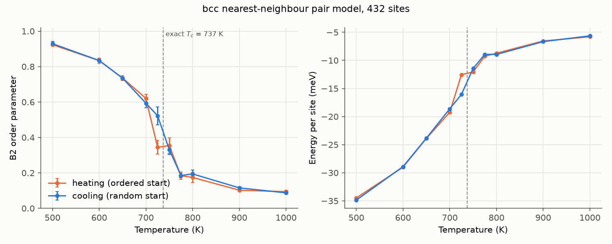

# B2 ordering in a nearest-neighbour pair model

A check that the Monte Carlo engine finds a known phase transition. A 50/50
Cu/Zn alloy on a bcc lattice (beta-brass) is given the simplest possible
alloy energy, a fixed cost for each nearest-neighbour pair:

$$E = J \sum_{\langle i j \rangle} s_i s_j, \qquad s_i = \begin{cases} +1 & \text{Cu} \\ -1 & \text{Zn} \end{cases}$$

where the sum runs over nearest-neighbour pairs.

This is the bcc Ising model, whose ordering temperature is known to high
precision: $`J / (k_B T_c) = 0.157373`$ (Butera & Comi 2000). With $`J`$ = 0.010 eV, **$`T_c`$ = 737 K**
(close to real beta-brass, which orders at about 740 K;
Chipman & Warren 1950, Keating & Warren 1951). Below $`T_c`$ the alloy
orders into B2 (CsCl): Cu on the cube corners, Zn on the body centres. No
MACE is needed, so a run takes minutes on a laptop.

| File | Role |
|---|---|
| `make_inputs.py` | Writes `parent.cif` and `initial_structures/`, and prints the run commands |
| `monte_carlo_settings.py` | `run-monte-carlo` settings file: run controls and the pair-model energy |
| `analysis.py` | Summarizes the runs in `results/raw/` into `results/summary.json` and `results/order_vs_temperature.png` |
| `parent.cif` | Disordered parent: 6 x 6 x 6 bcc supercell, 432 sites, each half Cu, half Zn |
| `initial_structures/ordered.cif` | Perfect B2, for heating runs |
| `initial_structures/random_seed0.cif` | Random arrangement, for cooling runs |

## Method

- **Moves.** The package's default moves: swap a random Cu and Zn atom. Atoms
  never leave their lattice sites.
- **Energy.** The pair model above, from the neighbour list of the starting
  structure (8 neighbours within 2.75 A per site). Perfect B2 has
  $`E = -1728\,J`$ = -17.28 eV.
- **Order parameter.** $`\text{order} = \lvert \sum_\text{corners} s_i - \sum_\text{body centres} s_i \rvert / N`$
  over the $`N`$ sites: 1 for perfect B2, 0.02 for the random start (finite-cell
  noise). Recorded with the energy for every step in `trajectory.json`.
- **Check.** Below 737 K both starts should end ordered; above it both
  should end disordered. In a finite cell the change is smoothed over a
  range of temperatures around $`T_c`$ rather than sharp.

## Settings

Inputs, at the top of `make_inputs.py`:

| Setting | Default | What it does |
|---|---|---|
| `LATTICE_A` | 2.95 A | bcc lattice parameter (beta-brass). Only sets the neighbour distances; the energy depends only on which sites are neighbours. |
| `SUPERCELL` | 6 | $`L`$ for an $`L \times L \times L`$ supercell of $`2L^3`$ sites. Larger cells give a sharper transition but need more steps. |
| `SEEDS` | `[0]` | Random starting arrangements. |
| `TEMPERATURES` | 500-1000 K, closer near $`T_c`$ | Only used to print the run commands; the temperature is a CLI argument. |

Run controls, in `monte_carlo_settings.py`:

| Setting | Default | What it does / how to choose |
|---|---|---|
| `J` | 0.010 eV | Pair energy. $`T_c = J / (0.157373\, k_B)`$, so 737 K here. |
| `cutoff` | 2.75 A | Neighbour cutoff, between the 1st (2.55 A) and 2nd (2.95 A) neighbour distances. Change it with `LATTICE_A`. |
| `num_steps` | 200,000 | About 460 attempted swaps per site for 432 sites. A step takes ~2.5 ms, so a run takes ~8 min. |
| `seed` | 0 | Seeds the Monte Carlo moves. |
| `output_dir` | `results/raw/<start>_T<T>K` | Named from the starting structure and temperature on the command line, so runs don't overwrite each other. Not committed. |

## Replicate

1. Install the package:
   ```bash
   pip install -e .
   ```
2. Write the inputs (already committed; rerun after changing the settings):
   ```bash
   python demos/bcc_ising_ordering/make_inputs.py
   ```
3. Run each printed command from the repository root, e.g.
   ```bash
   run-monte-carlo demos/bcc_ising_ordering/parent.cif demos/bcc_ising_ordering/initial_structures/ordered.cif 700 demos/bcc_ising_ordering/monte_carlo_settings.py
   ```
   The runs are independent, so run several at once (the 20 runs take
   ~40 min on 10 cores).
4. Summarize them and make the figure:
   ```bash
   python demos/bcc_ising_ordering/analysis.py
   ```

## Results



20 runs (10 temperatures x 2 starts), 200,000 steps each; the first half of
each run is discarded and the error bars are the spread of five blocks of
the rest (`results/summary.json`).

| T (K) | Order, heating (ordered start) | Order, cooling (random start) |
|---:|---:|---:|
| 500 | 0.92 | 0.93 |
| 600 | 0.83 | 0.83 |
| 650 | 0.74 | 0.74 |
| 700 | 0.62 | 0.59 |
| 725 | 0.34 | 0.52 |
| 750 | 0.35 | 0.33 |
| 775 | 0.18 | 0.19 |
| 800 | 0.17 | 0.19 |
| 900 | 0.10 | 0.12 |
| 1000 | 0.09 | 0.09 |

- **The transition is where it should be.** The order parameter falls
  steadily to 0.6 at 700 K, then drops sharply between 700 and 775 K,
  bracketing the exact $`T_c`$ = 737 K. The energy per site rises fastest over
  the same range.
- **Heating and cooling agree.** Runs from the ordered and the random start
  give the same order parameter (within ~0.03) and energy (within ~0.6 meV
  per site) at every temperature except 725 K, just below $`T_c`$. There the
  block averages range from 0.25 to 0.47 (heating) and 0.35 to 0.64
  (cooling): the slow, large fluctuations expected at a transition, not a
  run stuck where it started. The block error bars underestimate the uncertainty there,
  because the fluctuations last longer than a block.
- **Finite cell.** Above $`T_c`$ the order parameter levels off at ~0.1 instead
  of 0, the size of random fluctuations in a 432-site cell, and the
  transition is spread over ~50 K instead of being sharp. Locating $`T_c`$ more
  precisely would need several cell sizes (finite-size scaling) and more
  seeds.

## References

**Exact $`T_c`$**

- P. Butera & M. Comi, "Extension to order β^23 of the high-temperature expansions for the spin-1/2 Ising model on the simple-cubic and the body-centered-cubic lattices", *Phys. Rev. B* **62**, 14837 (2000): bcc critical coupling 0.1573725(6). [doi:10.1103/PhysRevB.62.14837](https://doi.org/10.1103/PhysRevB.62.14837)

**beta-brass**

- D. Chipman & B. E. Warren, "X-ray measurement of long range order in β-brass", *J. Appl. Phys.* **21**, 696 (1950). [doi:10.1063/1.1699733](https://doi.org/10.1063/1.1699733)
- D. T. Keating & B. E. Warren, "Long-range order in beta-brass and Cu3Au", *J. Appl. Phys.* **22**, 286 (1951). [doi:10.1063/1.1699944](https://doi.org/10.1063/1.1699944)

**Methods**

- N. Metropolis, A. W. Rosenbluth, M. N. Rosenbluth, A. H. Teller & E. Teller, "Equation of state calculations by fast computing machines", *J. Chem. Phys.* **21**, 1087 (1953). [doi:10.1063/1.1699114](https://doi.org/10.1063/1.1699114)
- S. P. Ong et al., "Python Materials Genomics (pymatgen): A robust, open-source python library for materials analysis", *Comput. Mater. Sci.* **68**, 314 (2013). [doi:10.1016/j.commatsci.2012.10.028](https://doi.org/10.1016/j.commatsci.2012.10.028)
