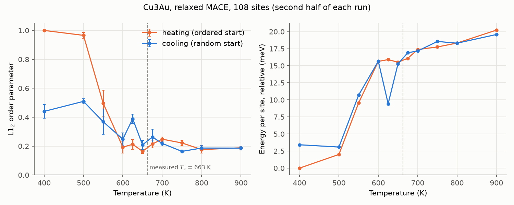
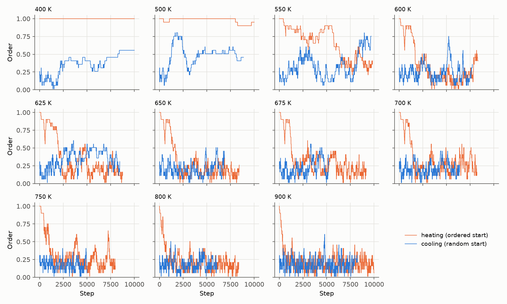

# L1₂ ordering in Cu3Au with MACE

Cu3Au is fcc. Below about 663 K (Okamoto et al. 1987) it orders into L1₂: Au on the cube
corners, Cu on the face centres. Above it, Cu and Au mix randomly over all
sites. This demo runs Monte Carlo with relaxed MACE energies at temperatures
around the transition, heating from the ordered structure and cooling from a
random one, to see where MACE puts the transition compared with experiment and
with first-principles cluster-expansion Monte Carlo (Ozoliņš et al. 1998).
The bcc Ising demo (`bcc_ising_ordering`) checks the same kind of calculation against an exactly known
transition temperature.

| File | Role |
|---|---|
| `make_inputs.py` | Writes `parent.cif` and `initial_structures/`, and prints the run commands |
| `monte_carlo_settings.py` | `run-monte-carlo` settings file: run controls, MACE settings, and the order parameter |
| `analysis.py` | Summarizes the runs in `results/raw/` and plots order and energy against temperature and step |
| `parent.cif` | Disordered parent: 3 x 3 x 3 fcc supercell, 108 sites, each 3/4 Cu, 1/4 Au |
| `initial_structures/ordered.cif` | Perfect L1₂, for heating runs |
| `initial_structures/random_seed0.cif` | Random arrangement, for cooling runs |

## Method

- **Moves.** The package's default moves: swap a random Cu and Au atom.
- **Energy.** Each candidate is relaxed with MACE (atom positions, cell
  fixed at a = 3.75 A) and scored by its relaxed energy. Relaxation matters
  because Au is much larger than Cu: with `MACE-matpes-r2scan-omat-ft`, one
  Cu/Au swap in perfect L1₂ costs 0.78 eV unrelaxed but 0.34 eV relaxed
  (0.343 eV with the cell relaxed too, at twice the cost). At 663 K,
  $`k_B T`$ = 0.057 eV.
- **Order parameter.** fcc splits into four simple-cubic sublattices (the
  corners and three sets of face centres). $`\text{order} = (f - \tfrac{1}{4}) / \tfrac{3}{4}`$,
  where $`f`$ is the Au fraction of the sublattice holding the most Au: 1 for
  perfect L1₂. A random arrangement gives ~0.1-0.2 in this small cell
  rather than 0, because the fullest sublattice is picked after the fact
  (0.21 for the random start). Recorded with the energy for every step in
  `trajectory.json`.
- **Check.** Heating and cooling runs should agree away from the
  transition and may disagree near it (the transition is first order).

## Settings

Inputs, at the top of `make_inputs.py`:

| Setting | Default | What it does |
|---|---|---|
| `LATTICE_A` | 3.75 A | fcc lattice parameter (Cu3Au). The cell stays at this size with `relax_cell = False`. |
| `SUPERCELL` | 3 | $`L`$ for an $`L \times L \times L`$ supercell of $`4L^3`$ sites. |
| `SEEDS` | `[0]` | Random starting arrangements. |
| `TEMPERATURES` | 400-900 K, closer near 663 K | Only used to print the run commands; the temperature is a CLI argument. |

Run controls, in `monte_carlo_settings.py`:

| Setting | Default | What it does / how to choose |
|---|---|---|
| `model_path` | (required) | MACE model file. |
| `device` | `"cpu"` | `"cuda"` for GPUs. |
| `relax`, `relax_cell` | `True`, `False` | Relax atom positions, not the cell (see Method). `relax = False` is ~3x faster but makes swaps about twice as costly. |
| `fmax` | 0.02 eV/A | Relaxation force threshold (the MgAl2O4 inversion demo, `mgal2o4_inversion`, found 0.05 too loose for energy differences). |
| `max_steps` | 1000 | Optimizer step cap per relaxation; `relax_converged` and `relax_steps` are recorded for every step. |
| `num_steps` | 10,000 | About 90 attempted swaps per site. A step takes ~10 s on a laptop CPU, so a run takes about a day. |
| `time_limit` | `None` | Seconds. The CLI only writes results when the run ends and cannot resume, so on a cluster set this a little below the job's wall time. |
| `seed` | 0 | Seeds the Monte Carlo moves. |
| `num_structures_to_save` | 10 | Lowest-energy configurations saved to `best_structures/`. |
| `output_dir` | `results/raw/<start>_T<T>K` | Named from the starting structure and temperature on the command line, so runs don't overwrite each other. Not committed. |

## Replicate

1. Install the package with the MACE extras:
   ```bash
   pip install -e ".[mace]"
   ```
2. Set `model_path` in `monte_carlo_settings.py`. The inputs are already
   committed; to change them, edit `make_inputs.py` and rerun:
   ```bash
   python demos/cu3au_ordering/make_inputs.py
   ```
3. Run each printed command from the repository root, e.g.
   ```bash
   run-monte-carlo demos/cu3au_ordering/parent.cif demos/cu3au_ordering/initial_structures/ordered.cif 600 demos/cu3au_ordering/monte_carlo_settings.py
   ```
4. Summarize the runs and make the figures:
   ```bash
   python demos/cu3au_ordering/analysis.py
   ```

## Results



22 runs (11 temperatures x 2 starts). Four reached 10,000 steps (heating
at 400, 500 and 900 K, cooling at 400 K); the others stopped at their
~71-hour time limit after 5,000-9,800 steps. No relaxation hit the step cap. The first half of each
run is discarded and the error bars are the spread of five blocks of the
rest (`results/summary.json`); energies are per site, relative to the
ordered start at 400 K.

| T (K) | Order, heating (ordered start) | Order, cooling (random start) |
|---:|---:|---:|
| 400 | 1.00 | 0.44 |
| 500 | 0.97 | 0.51 |
| 550 | 0.50 | 0.37 |
| 600 | 0.19 | 0.25 |
| 625 | 0.21 | 0.39 |
| 650 | 0.16 | 0.21 |
| 675 | 0.22 | 0.26 |
| 700 | 0.25 | 0.22 |
| 750 | 0.22 | 0.16 |
| 800 | 0.18 | 0.19 |
| 900 | 0.19 | 0.19 |



- **MACE puts the transition at about 550-625 K, 40-110 K below the
  measured 663 K.** The ordered start stays ordered at 400 and 500 K (order
  0.97-1.00). From 600 K up it disorders within ~2,000 steps and then
  fluctuates around 0.16-0.25, the level of a random arrangement in this cell. At 550 K it
  disorders slowly, from 0.9 to 0.4 over the run. Between 500 and 600 K the
  energy rises by ~14 meV per site, most of the total rise from 400 to
  900 K: the latent heat of the transition, spread out by the small cell.
- **Near the transition the cell fluctuates strongly.** At 550 K the
  cooling run climbs to 0.75 by the end, and at 625 K it holds order ~0.4-0.5
  for ~4,000 steps with an energy 6.5 meV per site below the heating run,
  so partly ordered states still occur at 625 K. With 108 sites (27 Au)
  the transition is spread over ~75 K; pinning it down would need larger
  cells and more seeds.
- **Below the transition, use the heating runs.** Cooling from random at
  400-500 K only reaches order 0.44-0.51, 1-3.5 meV per site above
  the heating runs. Ordering from random grows L1₂ domains that do not fit
  together, and with only 3-4% of swaps accepted these do not anneal out in
  10,000 steps. From 650 K up heating and cooling agree within ~0.06.
- **Cost.** The runs that hit the time limit averaged ~25-50 s per step,
  more than the ~10 s per step estimated above for a laptop CPU.

## References

**Cu-Au**

- H. Okamoto, D. J. Chakrabarti, D. E. Laughlin & T. B. Massalski, "The Au-Cu (gold-copper) system", *Bull. Alloy Phase Diagrams* (now *J. Phase Equilib.*) **8**, 454 (1987). [doi:10.1007/BF02893155](https://doi.org/10.1007/BF02893155)
- D. T. Keating & B. E. Warren, "Long-range order in beta-brass and Cu3Au", *J. Appl. Phys.* **22**, 286 (1951). [doi:10.1063/1.1699944](https://doi.org/10.1063/1.1699944)
- V. Ozoliņš, C. Wolverton & A. Zunger, "Cu-Au, Ag-Au, Cu-Ag, and Ni-Au intermetallics: First-principles study of temperature-composition phase diagrams and structures", *Phys. Rev. B* **57**, 6427 (1998). [doi:10.1103/PhysRevB.57.6427](https://doi.org/10.1103/PhysRevB.57.6427)

**Methods**

- N. Metropolis, A. W. Rosenbluth, M. N. Rosenbluth, A. H. Teller & E. Teller, "Equation of state calculations by fast computing machines", *J. Chem. Phys.* **21**, 1087 (1953). [doi:10.1063/1.1699114](https://doi.org/10.1063/1.1699114)
- S. P. Ong et al., "Python Materials Genomics (pymatgen): A robust, open-source python library for materials analysis", *Comput. Mater. Sci.* **68**, 314 (2013). [doi:10.1016/j.commatsci.2012.10.028](https://doi.org/10.1016/j.commatsci.2012.10.028)

**MACE**

- I. Batatia, D. P. Kovács, G. N. C. Simm, C. Ortner & G. Csányi, "MACE: Higher order equivariant message passing neural networks for fast and accurate force fields", *Adv. Neural Inf. Process. Syst.* **35** (NeurIPS 2022). [arXiv:2206.07697](https://arxiv.org/abs/2206.07697)
- I. Batatia et al., "A foundation model for atomistic materials chemistry" (2023). [arXiv:2401.00096](https://arxiv.org/abs/2401.00096)
- A. D. Kaplan et al., "A foundational potential energy surface dataset for materials" (2025), the MatPES r2SCAN data behind `MACE-matpes-r2scan-omat-ft`. [arXiv:2503.04070](https://arxiv.org/abs/2503.04070)
- L. Barroso-Luque et al., "Open Materials 2024 (OMat24) inorganic materials dataset and models" (2024). [arXiv:2410.12771](https://arxiv.org/abs/2410.12771)
