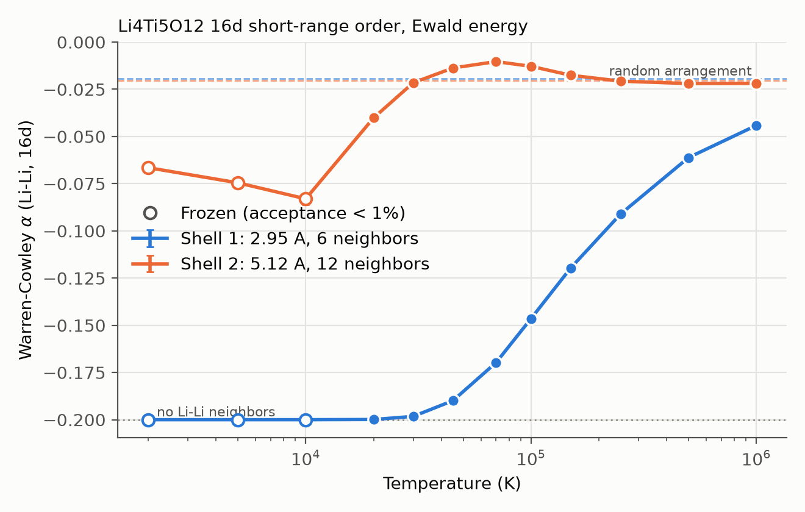
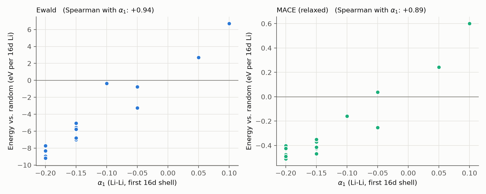

# Short-range order in Li4Ti5O12

In spinel Li4Ti5O12 the octahedral 16d sites are shared by Li+ (1/6) and
Ti4+ (5/6) with no long-range order. This demo measures how Li arranges
itself on those sites as a function of temperature: first with fast Ewald
Monte Carlo (`run.py`, minutes), checked against MACE energies, then with a
MACE Monte Carlo sweep at physical temperatures (`setup_sweep.py`, days on a
cluster).

| File | Role |
|---|---|
| `run.py` | Ewald Monte Carlo over 12 temperatures, and (with `--mace`) the MACE energy check |
| `setup_sweep.py` | Settings for the MACE Monte Carlo sweep; creates one folder per run, each with a `run_mc.py` |
| `mace_mc.py` | The MACE Monte Carlo run that each `run_mc.py` calls |
| `analysis.py` | Summarizes the results and makes the figures |
| `common.py` | Shared helpers: the 168-site cell, the short-range order, starting arrangements, file reading |

## Setup

- **Cell:** 2x2x3 supercell of the primitive spinel cell from
  `tests/test_structures/LTO_COD_1001098.cif`: 168 sites, of which 48 are
  16d sites holding 8 Li and 40 Ti. The conventional cell would need 2.67
  Li on 16d, which cannot be ordered at the correct composition.
- **Moves:** `sublattice_swap_policy`, so only 16d Li and Ti exchange; the
  8a Li and O never move.
- **Energy:** point-charge Ewald via `PrecomputedEwald`. Swaps never move
  sites, so the Ewald interaction matrix is computed once and each energy
  costs 0.2 ms instead of 65 ms for a full Ewald sum (identical to 1e-12
  eV).
- **Order parameter:** Warren-Cowley $`\alpha`$ (Cowley 1950) for Li-Li pairs on the first two
  16d neighbor shells (2.95 A, 6 neighbors; 5.12 A, 12 neighbors):

  ```math
  \alpha_n = \frac{P_n(\text{Li} \mid \text{Li}) - c}{1 - c},
  ```

  where $`P_n(\text{Li} \mid \text{Li})`$ is the probability that a shell-$`n`$ neighbor of a Li is
  also Li and $`c = 1/6`$. $`\alpha = -0.2`$
  means no Li has a Li neighbor in that shell; $`\alpha = 0`$ is uncorrelated in
  an infinite crystal. In this finite cell a random arrangement gives
  $`\alpha = -0.020`$ (a Li's neighbors are drawn from the other 7 Li), shown as
  the dashed baselines. The third shell (5.91 A) is exactly half a supercell
  vector, so periodic images coincide and its coordination is wrong; it is
  not reported.
- **Runs:** 12 temperatures from 2,000 K to $`10^6`$ K, 100k steps each with
  20k discarded, independent random starts, 12 parallel processes (14 min).

## Results (Ewald)



| T (K) | Acceptance | $`\alpha_1`$ | $`\alpha_2`$ |
|---:|---:|---:|---:|
| 2,000 | 0.002 | -0.200 | -0.067 (frozen) |
| 5,000 | 0.000 | -0.200 | -0.075 (frozen) |
| 10,000 | 0.008 | -0.200 | -0.083 (frozen) |
| 20,000 | 0.050 | -0.200 | -0.040 |
| 30,000 | 0.085 | -0.198 | -0.022 |
| 45,000 | 0.141 | -0.190 | -0.014 |
| 70,000 | 0.248 | -0.170 | -0.010 |
| 100,000 | 0.366 | -0.146 | -0.013 |
| 150,000 | 0.505 | -0.120 | -0.018 |
| 250,000 | 0.658 | -0.091 | -0.021 |
| 500,000 | 0.808 | -0.061 | -0.022 |
| 1,000,000 | 0.896 | -0.044 | -0.022 |

Block-averaged standard errors are 0.003 or smaller; the change between the
two halves of each production run is at most 0.006 (about 0.003 or less above
20,000 K).

- **First shell:** Ewald forbids nearest-neighbor Li-Li pairs completely up
  to ~20,000 K and only gradually allows them above ~30,000 K; even at $`10^6`$
  K $`\alpha_1`$ has not reached the random value.
- **Second shell:** at high temperature Li slightly *prefers* second-shell
  Li neighbors ($`\alpha_2`$ above the random baseline around 70,000 K), the
  usual compensation for first-shell avoidance. At lower temperature
  second-shell pairs are also avoided.
- **Frozen runs:** below ~20,000 K fewer than 1% of moves are accepted, so
  those runs sit in whichever low-energy arrangement they reached first.
  Their $`\alpha_2`$ values (hollow markers) are not equilibrium values and do
  not follow a trend; their error bars are zero only because nothing moves.

**Temperature scale:** as in the LiFeO2 exact-enumeration demo (`lifeo2_exact_enumeration`), unscreened formal charges make the
Li/Ti ordering energies so large that the temperature axis is not physical.
The qualitative result -- strong first-shell Li-Li avoidance -- is what the
MACE check below tests.

## MACE check

`run.py --mace MODEL` takes 6 Monte Carlo snapshots from the lowest
equilibrated temperature (20,000 K), 6 from the temperature where $`\alpha_1`$ is
halfway to random (150,000 K), and 6 random arrangements, and computes MACE
single-point and relaxed (positions + cell, fmax 0.05 eV/A) energies. It
runs serially using all cores (~75 s per relaxation) and caches finished
structures in `results/raw/`, so an interrupted run resumes.

Results with `MACE-matpes-r2scan-omat-ft.model`, energies per 16d Li
relative to the mean of the random arrangements (± standard error):

| Group | Mean $`\alpha_1`$ | Ewald | MACE single-point | MACE relaxed |
|---|---:|---:|---:|---:|
| MC 20,000 K | -0.200 | -8.85 ± 0.17 eV | -0.93 ± 0.03 eV | -0.46 ± 0.02 eV |
| MC 150,000 K | -0.158 | -6.45 ± 0.34 eV | -0.66 ± 0.04 eV | -0.40 ± 0.02 eV |
| Random | -0.033 | 0 | 0 | 0 |

Rank correlation of $`\alpha_1`$ with energy over all 18 structures: Ewald +0.94,
MACE single-point +0.95, MACE relaxed +0.89.



- **MACE agrees with Ewald on the direction:** arrangements with stronger
  first-shell Li-Li avoidance are lower in energy. Unlike the LiFeO2 demo, where
  MACE reversed Ewald's ranking, point-charge electrostatics gets the
  qualitative short-range order right here.
- **The magnitude is ~16-19x smaller with relaxation** (~10x without).
  Relaxation roughly halves the MACE energy gain, as the lattice
  accommodates Li-Li neighbors.
- **Most of MACE's energy gain is already reached at $`\alpha_1`$ = -0.16**
  (0.40 of 0.46 eV per Li), whereas Ewald keeps rewarding further avoidance
  more steeply (6.5 of 8.9 eV).

**Rough physical temperature scale (extrapolation, not a result):** if MACE
energies were simply Ewald's scaled down by 16-19x, the Ewald temperatures
would scale down by the same factor. First-shell avoidance would then start
to weaken around 1,600-1,900 K and $`\alpha_1`$ would reach about -0.15 near
5,000-6,000 K -- i.e. strong first-shell Li-Li avoidance would persist
through typical solid-state synthesis temperatures (~1,000-1,300 K). The
rank correlation is 0.89, not 1, so this needs a MACE-based Monte Carlo
run to confirm (next section).

## MACE Monte Carlo

The same Monte Carlo (same cell, same Li/Ti swaps on the 16d sites) with
every candidate scored by its MACE energy, at physical temperatures. This
replaces the scaled-Ewald estimate above with a direct calculation.

- **Energy.** Relaxed MACE energy (positions and cell) by default, or
  single-point energies at the ideal positions with `RELAX = False`. The
  MACE check found relaxation halves the energy gain from Li-Li avoidance,
  so the two give different temperature scales; relaxed is the physical
  one.
- **Starts.** `ordered`: the lowest-energy Ewald arrangement (no
  first-shell Li-Li pairs, $`\alpha_1`$ = -0.2), taken from
  `results/sro_summary.json`. `random`: a random arrangement. Both
  reaching the same $`\alpha`$ at a temperature is the equilibration check.
- **Recorded.** Every step records $`\alpha_1`$, $`\alpha_2`$ and the Ewald energy
  of the current arrangement, and the MACE energy of the proposal.
- **Long jobs.** As in the MgAl2O4 inversion demo (`mgal2o4_inversion`): each arrangement's energy is cached by its
  ordering key, so revisiting it is free, and a checkpoint is written after
  every step, so running the same script again continues exactly where it
  stopped.

The sweep is set at the top of `setup_sweep.py`:

| Setting | Default | What it does / how to choose |
|---|---|---|
| `MODEL` | (required) | MACE model file, as a path on the machine that runs the jobs. |
| `TEMPERATURES` | 600, 900, 1200, 1500, 2000, 3000 K | One run per temperature and start. The scaled-Ewald estimate puts the loss of first-shell avoidance around 1,600-1,900 K. |
| `STARTS` | `ordered`, `random` | See above. |
| `SEEDS` | `[0]` | Independent chains per temperature and start. |
| `RELAX`, `RELAX_CELL` | `True`, `True` | Relax positions and cell before reading the energy. `RELAX = False` is ~1 s per step instead of ~50 s. |
| `FMAX` | 0.02 eV/A | Relaxation threshold; the MgAl2O4 inversion demo found 0.05 too loose for energy differences in MgAl2O4. |
| `MAX_RELAX_STEPS` | 1000 | Optimizer step cap; relaxations that hit it are counted as unconverged in the summary. |
| `STEPS` | 100,000 | Total steps per run; in practice a job stops at its wall time and you resubmit to continue. |
| `THREADS` | `None` | Torch threads: `SLURM_CPUS_PER_TASK` under SLURM, else all cores. |
| `DEVICE` | `cpu` | `cuda` if the jobs run on GPUs. |
| `SWEEP_DIR` | `sweep/` in this folder | Where run folders go. Not committed. |

**Cost.** In a short test (`mace-mpa-0-medium`, fmax = 0.02, 10-core
laptop CPU), each relaxation took 43-55 s and converged in 56-68 optimizer
steps, so a run makes ~1,700 steps per day; single-point energies took ~1 s
per step. Early in a run nearly every proposal is a new arrangement, so the
cache helps little. `analysis.py` discards the first 500 steps, so a run
needs a few thousand steps to be useful.

Each run folder is an independent job: run `python -u run_mc.py` in it,
locally or on a cluster (see "Running on a cluster" in `demos/mgal2o4_inversion/README.md` for
a SLURM script). A finished run prints `Finished` and exits. Don't edit a
run's `run_mc.py` after it has started, except `steps`: the run refuses to
continue with a changed temperature, start, seed, model, or relaxation
setting.

Each run folder holds `metadata.json`, `steps.jsonl` (one line per step),
`energy_cache.jsonl`, and `checkpoint.json`. `analysis.py` discards the
first max(500 steps, 20%) of each run and writes `results/mace_mc_summary.json`
and `results/mace_sro_vs_temperature.png` (alpha_1 and $`\alpha_2`$ against
temperature for both starts).

**Results:** pending the sweep.

## Reproduce

```bash
python demos/li4ti5o12_short_range_order/run.py --jobs 12                  # ~14 min
python demos/li4ti5o12_short_range_order/run.py --mace MODEL_PATH          # MACE check
python demos/li4ti5o12_short_range_order/setup_sweep.py                    # MACE Monte Carlo: edit MODEL first
python demos/li4ti5o12_short_range_order/sweep/T1200K_random_seed0/run_mc.py  # one run; rerun to resume
python demos/li4ti5o12_short_range_order/analysis.py                       # figures
```

## References

**Structure**

- A. Deschanvres, B. Raveau & Z. Sekkal, "Mise en evidence et etude cristallographique d'une nouvelle solution solide de type spinelle Li1+xTi2-xO4", *Mater. Res. Bull.* **6**, 699 (1971); COD 1001098, the Li4Ti5O12 structure used here. [doi:10.1016/0025-5408(71)90103-6](https://doi.org/10.1016/0025-5408(71)90103-6)
- S. Gražulis et al., "Crystallography Open Database -- an open-access collection of crystal structures", *J. Appl. Cryst.* **42**, 726 (2009). [doi:10.1107/S0021889809016690](https://doi.org/10.1107/S0021889809016690)

**Methods**

- N. Metropolis, A. W. Rosenbluth, M. N. Rosenbluth, A. H. Teller & E. Teller, "Equation of state calculations by fast computing machines", *J. Chem. Phys.* **21**, 1087 (1953). [doi:10.1063/1.1699114](https://doi.org/10.1063/1.1699114)
- P. P. Ewald, "Die Berechnung optischer und elektrostatischer Gitterpotentiale", *Ann. Phys.* **369**, 253 (1921). [doi:10.1002/andp.19213690304](https://doi.org/10.1002/andp.19213690304)
- J. M. Cowley, "An approximate theory of order in alloys", *Phys. Rev.* **77**, 669 (1950). [doi:10.1103/PhysRev.77.669](https://doi.org/10.1103/PhysRev.77.669)
- S. P. Ong et al., "Python Materials Genomics (pymatgen): A robust, open-source python library for materials analysis", *Comput. Mater. Sci.* **68**, 314 (2013). [doi:10.1016/j.commatsci.2012.10.028](https://doi.org/10.1016/j.commatsci.2012.10.028)

**MACE**

- I. Batatia, D. P. Kovács, G. N. C. Simm, C. Ortner & G. Csányi, "MACE: Higher order equivariant message passing neural networks for fast and accurate force fields", *Adv. Neural Inf. Process. Syst.* **35** (NeurIPS 2022). [arXiv:2206.07697](https://arxiv.org/abs/2206.07697)
- I. Batatia et al., "A foundation model for atomistic materials chemistry" (2023). [arXiv:2401.00096](https://arxiv.org/abs/2401.00096)
- A. D. Kaplan et al., "A foundational potential energy surface dataset for materials" (2025), the MatPES r2SCAN data behind `MACE-matpes-r2scan-omat-ft`. [arXiv:2503.04070](https://arxiv.org/abs/2503.04070)
- L. Barroso-Luque et al., "Open Materials 2024 (OMat24) inorganic materials dataset and models" (2024). [arXiv:2410.12771](https://arxiv.org/abs/2410.12771)
