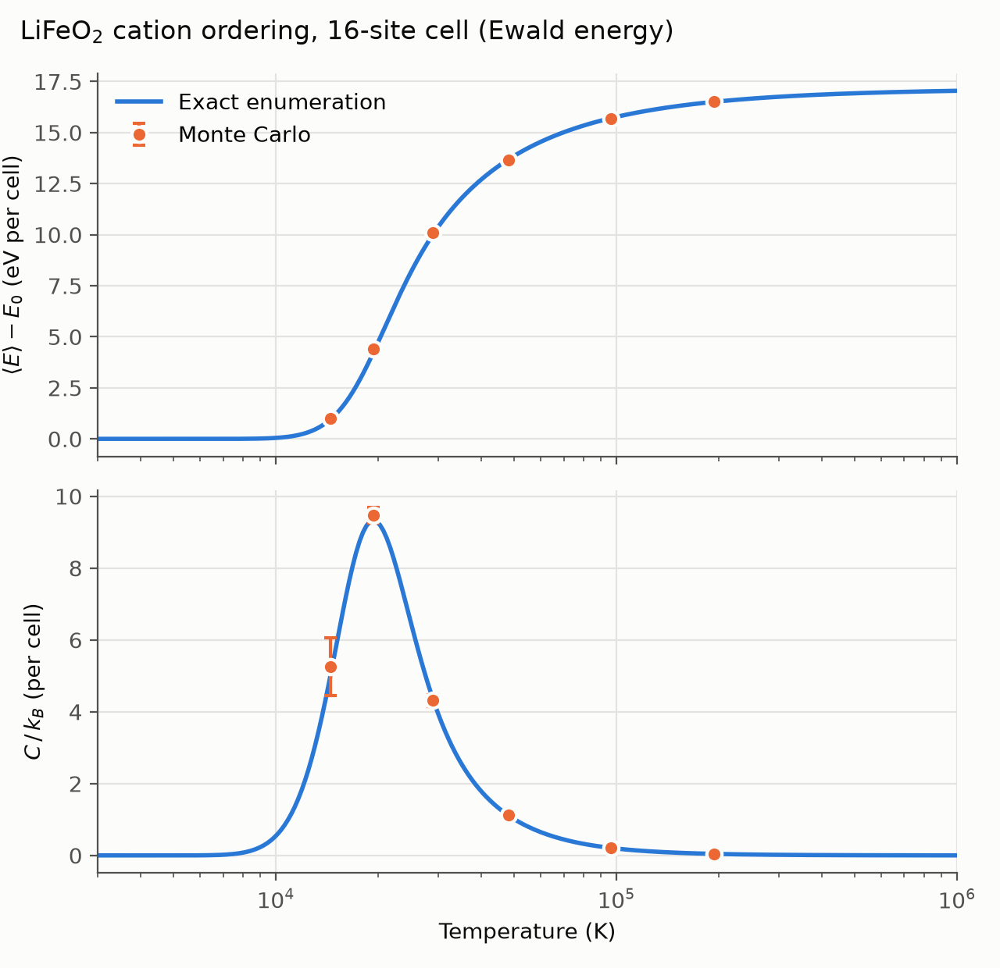
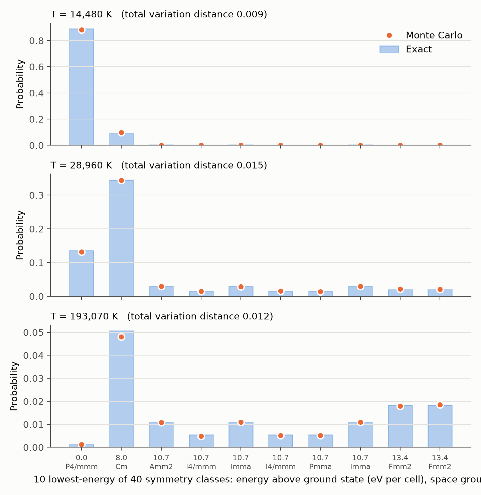
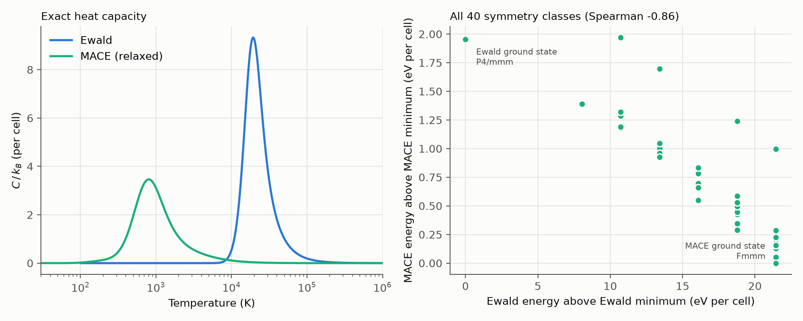

# Exact enumeration validation

Checks that the Monte Carlo engine samples the correct Boltzmann
distribution, and that the symmetry module counts equivalent orderings
correctly, on a system small enough to solve exactly.

## System

Disordered rock-salt α-LiFeO2: Li+ and Fe3+ share the cation sublattice
50/50 (a = 4.158 A). The parent is a 32-site supercell of the conventional
cell (matrix `[[-1,1,1],[1,-1,1],[1,1,-1]]`) that keeps the full Fm-3m
symmetry, giving 768 site permutations. Its 16 cation sites have
C(16, 8) = 12870 orderings, each scored with `disordered_ewald_energy`.

## What `run.py` checks

1. **Symmetry.** Orderings are grouped into classes by canonicalizing under
   the parent's site permutations. Each class size is compared with
   `configuration_degeneracy`, the sizes must sum to 12870, and every member
   of a class must have the same Ewald energy.
2. **Thermodynamics.** Exact $`\langle E \rangle(T)`$ and $`C(T)`$ come from the full Boltzmann
   sum. Metropolis Monte Carlo with `sublattice_swap_policy` (real Ewald
   evaluations every step, 60k steps, 6k discarded) runs at 0.75x-10x the
   exact heat-capacity peak. Errors are block-averaged over 20 blocks.
3. **Distribution.** The fraction of steps spent in each symmetry class is
   compared with the exact $`g_i\, e^{-E_i / k_B T} / Z`$, where $`g_i`$ is the class size.

## Results

Symmetry: 40 classes, degeneracies sum to 12870 and match
`configuration_degeneracy` for every class, and energies within a class
agree to 2e-13 eV. The ground state is the layered P4/mmm ordering
(g = 6), 8.0 eV per cell below the next class (Cm, g = 384).

| T (K) | Acceptance | <E> z-score | C z-score | Class TVD |
|---:|---:|---:|---:|---:|
| 14,480 | 0.03 | +0.29 | +0.27 | 0.009 |
| 19,310 | 0.16 | +0.73 | +0.67 | 0.019 |
| 28,960 | 0.44 | +0.51 | -0.12 | 0.015 |
| 48,270 | 0.69 | -0.72 | +1.21 | 0.016 |
| 96,530 | 0.86 | -0.49 | -0.53 | 0.011 |
| 193,070 | 0.93 | +0.65 | -1.51 | 0.012 |

z-score = (MC - exact) / MC standard error; TVD = total variation distance
between MC and exact class probabilities. Every MC step's energy also
matched the enumerated energy of the configuration it was in.





## Caveat: temperature scale

Unscreened formal point charges make cation-ordering energies very large
(8 eV per 16-cation cell to the first excited class), so the heat-capacity
peak sits near 19,000 K. This does not affect the validation, which only
compares MC against exact results for the same energy function, but these
temperatures are not physical. The peak is also a finite-cell
(Schottky-like) feature, not a phase transition.

## Optional: exact thermodynamics with MACE

`run.py --mace MODEL` reuses the saved enumeration. Since energies are
identical within a symmetry class, exact MACE thermodynamics need one
calculation per class rather than one per ordering: a relaxed (positions +
cell, fmax 0.05 eV/A) energy for each of the 40 class representatives, plus
single-point energies of a second member of each class to confirm the
energies match. No Monte Carlo is run; the sampler check above does not
depend on the energy model.

Results with `MACE-matpes-r2scan-omat-ft.model` (7 min on 6 CPU processes):

- Single-point energies of two members of each class agree to 1e-13 eV.
- **MACE ranks the classes nearly opposite to Ewald** (Spearman -0.86). The
  MACE ground state (Fmmm, g = 96) is in Ewald's highest energy level, and
  Ewald's ground state (P4/mmm) is near the top of MACE's range.
- The driver is the number of nearest-neighbor Li-Fe cation pairs (48-64 of
  96 per cell). Ewald energy falls as that number rises (Spearman -0.99 with
  energy); MACE energy rises with it (+0.87). The seven lowest MACE classes
  all have 48 unlike pairs, the minimum in this cell -- 6 unlike neighbors
  per cation, the same count as α-NaFeO2-type layered ordering.
- The trend survives without relaxation (single-point vs. relaxed Spearman
  +0.83), so it is not a relaxation artifact.
- The MACE energy range is 2.0 eV per cell versus 21.5 eV for Ewald, and the
  heat-capacity peak falls from ~19,000 K to ~800 K (~700 K single-point).

Caveats: the lowest MACE classes are separated by as little as 0.05 eV per
cell (~1.6 meV/atom), below typical MLIP error, so their relative order is
not reliable. This cell cannot represent the real ordered LiFeO2 phases
(γ-LiFeO2, α-NaFeO2 layering), so these results describe this
constrained cell, not bulk LiFeO2.



## Reproduce

```bash
python demos/lifeo2_exact_enumeration/run.py                     # ~10 min on 6 cores
python demos/lifeo2_exact_enumeration/run.py --mace MODEL_PATH   # optional, ~7 min
python demos/lifeo2_exact_enumeration/analysis.py                # figures
```

A reduced 8-site version runs in the test suite as
`tests/test_exact_enumeration.py`.

## References

**Methods**

- N. Metropolis, A. W. Rosenbluth, M. N. Rosenbluth, A. H. Teller & E. Teller, "Equation of state calculations by fast computing machines", *J. Chem. Phys.* **21**, 1087 (1953). [doi:10.1063/1.1699114](https://doi.org/10.1063/1.1699114)
- P. P. Ewald, "Die Berechnung optischer und elektrostatischer Gitterpotentiale", *Ann. Phys.* **369**, 253 (1921). [doi:10.1002/andp.19213690304](https://doi.org/10.1002/andp.19213690304)
- S. P. Ong et al., "Python Materials Genomics (pymatgen): A robust, open-source python library for materials analysis", *Comput. Mater. Sci.* **68**, 314 (2013). [doi:10.1016/j.commatsci.2012.10.028](https://doi.org/10.1016/j.commatsci.2012.10.028)

**MACE**

- I. Batatia, D. P. Kovács, G. N. C. Simm, C. Ortner & G. Csányi, "MACE: Higher order equivariant message passing neural networks for fast and accurate force fields", *Adv. Neural Inf. Process. Syst.* **35** (NeurIPS 2022). [arXiv:2206.07697](https://arxiv.org/abs/2206.07697)
- I. Batatia et al., "A foundation model for atomistic materials chemistry" (2023). [arXiv:2401.00096](https://arxiv.org/abs/2401.00096)
- A. D. Kaplan et al., "A foundational potential energy surface dataset for materials" (2025), the MatPES r2SCAN data behind `MACE-matpes-r2scan-omat-ft`. [arXiv:2503.04070](https://arxiv.org/abs/2503.04070)
- L. Barroso-Luque et al., "Open Materials 2024 (OMat24) inorganic materials dataset and models" (2024). [arXiv:2410.12771](https://arxiv.org/abs/2410.12771)
