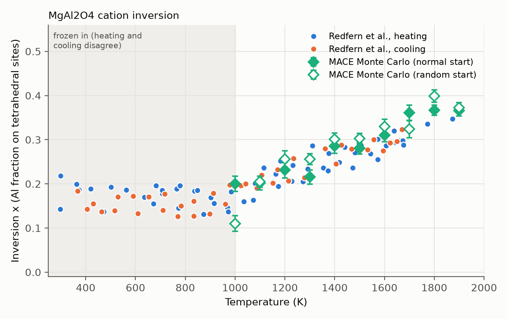

# Cation inversion in MgAl2O4

In normal spinel MgAl2O4, Mg fills the tetrahedral sites and Al the
octahedral sites. At high temperature some Mg and Al exchange; the inversion
$`x`$ is the fraction of tetrahedral sites holding Al ($`x = 2/3`$ is fully random).
This demo runs Monte Carlo with relaxed MACE energies to predict $`x(T)`$ and
compares it with in situ measurements.

| File | Role |
|---|---|
| `setup_sweep.py` | Settings for the sweep; creates one folder per run, each with a `run_mc.py` |
| `mace_mc.py` | The Monte Carlo run that each `run_mc.py` calls |
| `analysis.py` | Summarizes the runs and plots $`x(T)`$ against the data |
| `fmax_test.py` | Optional check of the relaxation threshold |
| `common.py` | Shared helpers: the 112-atom cell, configuration keys, file reading |
| `data/` | Redfern et al. (1999) data and the reference CIF |

## Experimental data

Redfern, Harrison, O'Neill & Wood, *Am. Mineral.* **84**, 299-310 (1999):
in situ neutron diffraction up to 1873 K, 96 refined structures in five
heating/cooling runs (COD 9002044-9002139). `data/parse_redfern.py` extracts
temperature, leg, a, oxygen parameter u, and x into `data/redfern1999.csv`;
`data/cifs/9002082.cif` (298 K) is the starting geometry.

Above ~1000 K heating and cooling agree, so $`x`$ is in equilibrium: it rises
from ~0.17-0.20 at 1000 K to ~0.30 at 1650 K and 0.35 at 1873 K (scatter
~±0.02). Below ~900 K $`x`$ is frozen in and reflects sample history, not
equilibrium.

## Method

- **Cell.** A 2x2x2 supercell of the primitive cell: 112 atoms, 16 formula
  units, 16 tetrahedral and 32 octahedral cation sites.
- **Moves.** `sublattice_swap_policy` with all 48 cation sites in one group:
  any Mg/Al pair may swap, so $`x`$ can change; oxygen never moves.
- **Energy.** Every candidate is relaxed with MACE (positions and cell) and
  scored by its relaxed energy, with Metropolis acceptance. Relaxed, one
  Mg-Al exchange costs 0.32-0.44 eV depending on how many are already
  present (`results/fmax_test.json`), the scale of $`k_B T`$ at these temperatures.
- **Long jobs.** Each configuration's relaxed energy is cached, so
  revisiting it is free. A checkpoint is written after every step, so a
  killed job loses at most the relaxation in progress, and running the
  same script again continues exactly where it stopped (`resume_monte_carlo`).

## Relaxation threshold

The energy *differences* between configurations must be accurate compared
with $`k_B T`$ (0.09-0.16 eV over 1000-1873 K). `fmax_test.py` relaxes
configurations with 0, 1, 4, and 8 inversions while tightening fmax, and
compares energy differences with fmax = 0.01 eV/A
(`MACE-matpes-r2scan-omat-ft`, 12 CPU threads):

| fmax (eV/A) | Worst error in a cell energy difference | vs. $`k_B T`$ at 1000 K | Mean time per relaxation |
|---:|---:|---:|---:|
| 0.2 | 71 meV | 0.8 $`k_B T`$ | 10 s |
| 0.1 | 15 meV | 0.18 $`k_B T`$ | 13 s |
| 0.05 | 13 meV | 0.15 $`k_B T`$ | 27 s |
| 0.02 | 1.7 meV | 0.02 $`k_B T`$ | 40 s |
| 0.01 | -- | -- | 58 s |

Under-relaxed inverted configurations come out too high, which biases $`x`$
low, so the sweep uses **fmax = 0.02**. To check another model:

```bash
python demos/mgal2o4_inversion/fmax_test.py --model /path/to/model.model
```

## Choosing settings

The sweep is set at the top of `setup_sweep.py`:

| Setting | Default | What it does / how to choose |
|---|---|---|
| `MODEL` | (required) | MACE model file, as a path on the machine that runs the jobs. |
| `TEMPERATURES` | 1000-1900 K, every 100 K | One run per temperature. The data are in equilibrium only above ~1000 K. |
| `STARTS` | `normal`, `random` | Starting arrangement: $`x = 0`$ or random ($`x \approx 2/3`$). Running both and seeing them converge to the same $`x`$ is the equilibration check. |
| `SEEDS` | `[0]` | Independent chains per temperature and start. More seeds narrow the error bars without longer runs. |
| `FMAX` | 0.02 eV/A | Relaxation threshold; see the table above. Rerun `fmax_test.py` if you change the model. |
| `MAX_RELAX_STEPS` | 1000 | Optimizer step cap. Relaxations that hit it are counted in the summary as unconverged; raise it if that count is not ~0. |
| `STEPS` | 100,000 | Total steps per run. In practice a job stops at its wall time and you resubmit to continue, so this is an upper bound. |
| `THREADS` | `None` | Torch threads. `None` uses `SLURM_CPUS_PER_TASK` when running under SLURM, else all cores, so normally you set the CPU count in the job, not here. |
| `DEVICE` | `cpu` | `cuda` if the jobs run on GPUs. |
| `SWEEP_DIR` | `sweep/` in this folder | Where run folders go, e.g. a scratch filesystem on a cluster. |

**Cost.** A new relaxation takes ~40 s on 12 CPU threads at fmax = 0.02;
a revisited configuration is free. Early in a run nearly every proposal is
new, so expect ~2,000 steps per day per run, or ~13,000 steps in a 6-day
job. `analysis.py` discards the first max(500 steps, 20%) of each run as
equilibration, so a run needs at least a few thousand steps to be useful.

**Rules.**

- To try different settings, edit `setup_sweep.py` and rerun it; folders
  that already exist are left alone, so new settings need new folders (for
  example a different `SEEDS` value, or a different `SWEEP_DIR`). Don't edit
  a run's `run_mc.py` after it has started: the run refuses to continue with
  changed temperature, start, seed, model, fmax, or step cap.
- Never run two jobs on the same folder at once.

## Running on a cluster

Each run folder is an independent job: `cd` into it and run
`python -u run_mc.py`. A job killed at its time limit loses at most one
relaxation; submitting the same folder again resumes it.

A minimal SLURM job script to adapt (save it anywhere, e.g. `job.sh`):

```bash
#!/bin/bash
#SBATCH --job-name=mgal2o4-mc
#SBATCH --nodes=1
#SBATCH --ntasks=1
#SBATCH --cpus-per-task=16
#SBATCH --time=6-00:00:00
#SBATCH --output=slurm-%j.out
# Add --partition, --account, --mem, ... as your cluster requires.

# Your environment setup, e.g.:
# module load python/3.11
# source /path/to/venv/bin/activate

python -u run_mc.py
```

Submit one job per run folder; `--chdir` runs each job inside its folder, so
the log lands there too:

```bash
for d in demos/mgal2o4_inversion/sweep/*/; do sbatch --chdir="$d" job.sh; done
```

Run the same loop again to resume every run after the time limit, or
`sbatch --chdir=demos/mgal2o4_inversion/sweep/T1500K_random_seed0 job.sh`
for one. A finished run just prints `Finished` and exits.

## Replicate

1. Install the package with the MACE extras on the machine that will run
   the jobs:
   ```bash
   pip install -e ".[mace,notebooks]"
   ```
2. Edit the settings block at the top of `setup_sweep.py` (at least
   `MODEL`), then create the run folders:
   ```bash
   python demos/mgal2o4_inversion/setup_sweep.py
   ```
3. Run each folder's `run_mc.py`, locally or as cluster jobs (above), and
   resubmit until the runs are long enough.
4. Copy the sweep folder back if needed (set `SWEEP_DIR` at the top of
   `analysis.py` if it is not `sweep/`), then:
   ```bash
   python demos/mgal2o4_inversion/analysis.py
   ```

## Outputs

Each run folder holds `run_mc.py` and:

- `metadata.json` -- the run's settings and cell size;
- `steps.jsonl` -- one line per step: current energy and x, the proposal's
  energy and x, whether it was accepted, relaxation convergence, steps and
  time, cache hit, and the swapped sites;
- `energy_cache.jsonl` -- the relaxed energy of every configuration seen;
- `checkpoint.json` -- the state needed to resume.

`analysis.py` writes `results/mace_mc_summary.json` (per run: steps, x with
a block-averaged error, the change in x between the two halves of the
production run, acceptance and cache-hit rates, unconverged relaxations) and
`results/inversion_vs_temperature.png`, and compares each run's x with the
measured equilibrium points within 60 K of its temperature.

## Results



20 runs (10 temperatures x 2 starts), 3,800-12,200 steps each, with
`mace-mpa-0-medium` and fmax = 0.02 eV/A. No relaxation hit the step cap.
The relaxation-threshold test above used `MACE-matpes-r2scan-omat-ft`, not
this model; rerunning `fmax_test.py` with `mace-mpa-0-medium` would confirm
that fmax = 0.02 is tight enough for it too. Each run's first max(500 steps, 20%) is discarded
(`results/mace_mc_summary.json`). "Measured" is the mean of Redfern et al.'s
points within 60 K (number of points in brackets); the last column compares
the mean of the two starts with it.

| T (K) | $`x`$, normal start | $`x`$, random start | Measured | MC - measured |
|---:|---:|---:|---:|---:|
| 1000 | 0.20 | 0.11 | 0.19 (3) | -0.03 |
| 1100 | 0.20 | 0.20 | 0.20 (8) | +0.00 |
| 1200 | 0.23 | 0.26 | 0.22 (9) | +0.02 |
| 1300 | 0.22 | 0.26 | 0.24 (6) | -0.00 |
| 1400 | 0.29 | 0.30 | 0.26 (8) | +0.03 |
| 1500 | 0.28 | 0.30 | 0.28 (9) | +0.01 |
| 1600 | 0.31 | 0.33 | 0.29 (10) | +0.03 |
| 1700 | 0.36 | 0.32 | 0.30 (6) | +0.04 |
| 1800 | 0.37 | 0.40 | 0.34 (1) | +0.05 |
| 1900 | 0.37 | 0.37 | 0.35 (1) | +0.02 |

- **MACE reproduces the measured inversion.** From 1100 to 1600 K the
  Monte Carlo $`x`$ is within 0.03 of the measurements, and it rises with
  temperature at about the measured rate. Above 1600 K it runs 0.02-0.05 high,
  where there are few measured points. Over all 20 runs, MC - measured has
  mean +0.02 and rms 0.03, comparable to the scatter of the data (~0.02).
- **Normal and random starts agree from 1100 K up**, within ~0.04
  (at most about twice their error bars). At 1000 K they do not: the random start
  fell to $`x \approx 0.03`$ within ~1,000 steps and was still at 0.11 after 7,800
  steps, against 0.20 for the normal start. Exchanges are rarely accepted at
  1000 K (5-9%), so this temperature is not equilibrated, and the random
  start's value should not be used.
- **The error bars are too small.** $`x`$ changes in steps of 1/16 (16
  tetrahedral sites) and wanders by ~0.1 over hundreds of steps. The
  autocorrelation time is 70-540 steps, so each run holds only ~10-60
  independent samples. Errors estimated from the autocorrelation time are
  0.013-0.038, larger than the plotted block errors (0.011-0.020), and the
  drift between the two halves of each run (up to 0.07) is of the same
  size. Treat differences below ~0.04 as noise.
- **Cost.** A new relaxation took 45-140 s on average depending on the run,
  slower than the ~40 s estimated above, so the runs are shorter than
  planned. Revisited configurations were rare (cache hits ~1-3%, 24% for the
  1000 K random start). More seeds per temperature would narrow the
  uncertainty more cheaply than longer runs.

## References

**Experimental data**

- S. A. T. Redfern, R. J. Harrison, H. St.C. O'Neill & D. R. R. Wood, "Thermodynamics and kinetics of cation ordering in MgAl2O4 spinel up to 1600 °C from in situ neutron diffraction", *Am. Mineral.* **84**, 299 (1999); COD 9002044-9002139.
- S. Gražulis et al., "Crystallography Open Database -- an open-access collection of crystal structures", *J. Appl. Cryst.* **42**, 726 (2009). [doi:10.1107/S0021889809016690](https://doi.org/10.1107/S0021889809016690)

**Methods**

- N. Metropolis, A. W. Rosenbluth, M. N. Rosenbluth, A. H. Teller & E. Teller, "Equation of state calculations by fast computing machines", *J. Chem. Phys.* **21**, 1087 (1953). [doi:10.1063/1.1699114](https://doi.org/10.1063/1.1699114)
- S. P. Ong et al., "Python Materials Genomics (pymatgen): A robust, open-source python library for materials analysis", *Comput. Mater. Sci.* **68**, 314 (2013). [doi:10.1016/j.commatsci.2012.10.028](https://doi.org/10.1016/j.commatsci.2012.10.028)

**MACE**

- I. Batatia, D. P. Kovács, G. N. C. Simm, C. Ortner & G. Csányi, "MACE: Higher order equivariant message passing neural networks for fast and accurate force fields", *Adv. Neural Inf. Process. Syst.* **35** (NeurIPS 2022). [arXiv:2206.07697](https://arxiv.org/abs/2206.07697)
- I. Batatia et al., "A foundation model for atomistic materials chemistry" (2023). [arXiv:2401.00096](https://arxiv.org/abs/2401.00096)
- A. D. Kaplan et al., "A foundational potential energy surface dataset for materials" (2025), the MatPES r2SCAN data behind `MACE-matpes-r2scan-omat-ft`. [arXiv:2503.04070](https://arxiv.org/abs/2503.04070)
- L. Barroso-Luque et al., "Open Materials 2024 (OMat24) inorganic materials dataset and models" (2024). [arXiv:2410.12771](https://arxiv.org/abs/2410.12771)
